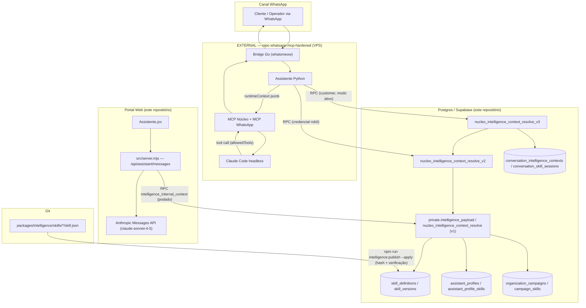
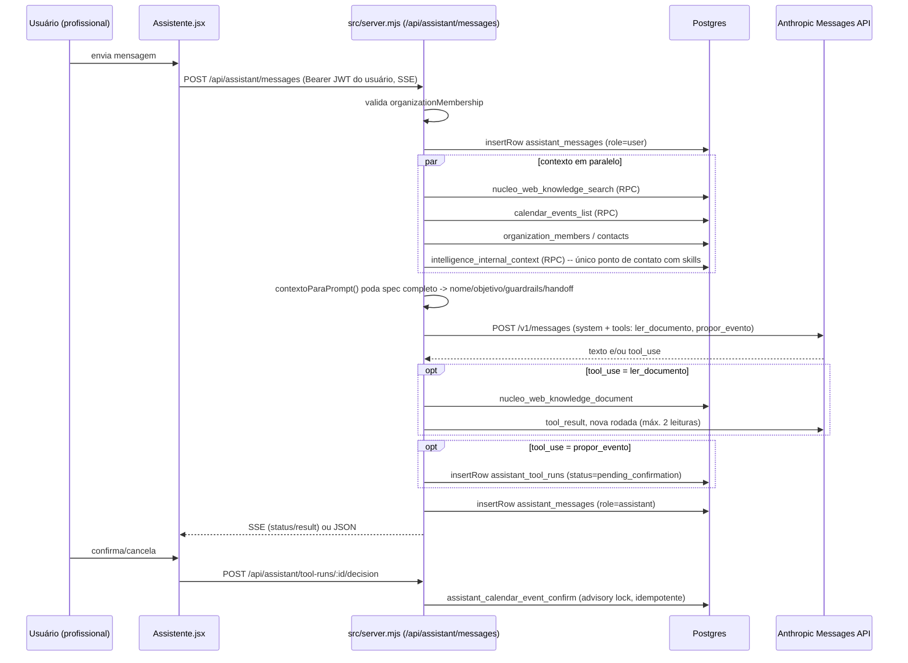

# Baseline — Arquitetura Atual do Sistema de Inteligência (nucleomajor / EmyLeads)

> Auditoria técnica read-only. Nenhum arquivo de produção foi alterado para produzir este documento.
> Branch auditada: `agenda-e-tarefas-da-equipe`. Data: 2026-09-03.
> Convenção de citação: `arquivo:linha`. Onde a informação não existe neste repositório, está marcada **EXTERNAL / NÃO DISPONÍVEL NESTE REPOSITÓRIO**.

---

## 1. Resumo executivo

O sistema de inteligência do EmyLeads é **dois produtos de IA distintos que compartilham um banco de dados**, não uma arquitetura única:

1. **WhatsApp (clientes e operadores)** — o roteamento e a execução de skills acontecem via funções PL/pgSQL no Postgres (`nucleo_intelligence_context_resolve`, `_v2`, `_v3`), consumidas por um runtime **fora deste repositório** (Bridge Go + assistente Python, repositório `whatsapp-mcp-hardened`, rodando na VPS), que fala com o modelo via MCP/Claude Code.
2. **Portal Web** (`/app/assistente`) — implementado inteiramente em `src/server.mjs`, chama a Anthropic Messages API diretamente, com apenas 2 ferramentas fixas (`ler_documento`, `propor_evento`). Toca o sistema de skills apenas de forma indireta e podada (nome/objetivo/guardrails/handoff, nunca `workflow`/`instructionsMarkdown`/`allowedTools`).

O catálogo de **skills** (7 hoje: `recepcao`, `pre-qualificacao`, `vendas`, `suporte`, `solicitacao-agenda` — customer; `agenda`, `tarefas` — internal) vive como fonte de verdade em **Git** (`packages/intelligence/skills/*/skill.json`) para skills `platform`, publicado no banco (`skill_definitions`) via pipeline com hash de conteúdo e verificação pós-escrita. Skills privadas de organização (`owner_type='organization'`, criadas por wizard no portal) só existem no banco — não têm arquivo Git correspondente.

**Achado mais crítico da auditoria**: existem **quatro implementações de roteamento** de skill/estágio (`private.intelligence_payload`/v1, `nucleo_intelligence_context_resolve_v2`, `_v3`, e um roteador JS client-side só para o simulador) com regras que **divergem de fato**, não apenas em teoria. Em particular, `nucleo_intelligence_context_resolve_v3` — a função descrita como "modo ativo" para clientes externos — valida `allowedTools` contra uma lista de **10 ferramentas nunca atualizada desde 24/08**, enquanto `v2` já foi corrigida duas vezes e tem **15**. Faltam em v3 exatamente as duas ferramentas (`calendar.request.prepare`, `calendar.request.submit`) que a skill `solicitacao-agenda` — pensada para clientes externos — precisa para funcionar. Um comentário na migration mais recente (`20260830060000`) afirma que "v3 não precisa mudar, ela delega a v2 e herda a lista" — isso é **factualmente falso** pela leitura do código atual, e o teste de regressão existente não detecta a divergência porque seu algoritmo de busca por "a lista SQL vigente" pega a ocorrência mais recente por nome de arquivo, não por função.

Isso é o pano de fundo mais importante para qualquer decisão de "Channel → Message Gateway → Context Resolver → Intent Resolver → Agent Router → Skill Router → Workflow Engine → Permission Engine → Tools": hoje já existem 2+ "Context/Skill Resolvers" reais rodando em paralelo sem uma fonte de verdade única, e a consolidação disso é provavelmente mais urgente — e mais arriscada de fazer errado — do que introduzir o conceito novo de "agente configurável".

---

## 2. Arquitetura atual



Dois pontos estruturais a reter:
- O Postgres é **o único ponto de contato entre os dois mundos** — mas cada mundo o consome de forma incompatível (o portal poda o payload; o WhatsApp recebe o `spec` completo).
- Não existe hoje nenhum componente que corresponda a "Agent Router" na direção futura descrita — o mais próximo é a escolha de `assistant_profile` por `(organization_id, audience)`, que é uma unicidade de banco, não um roteador.

---

## 3. Fluxo WhatsApp

```mermaid
sequenceDiagram
    participant C as Cliente/Operador (WhatsApp)
    participant BR as Bridge Go [EXTERNAL]
    participant PY as Assistente Python [EXTERNAL]
    participant PG as Postgres (este repo)
    participant MCP as MCP Núcleo/WhatsApp [EXTERNAL]
    participant CC as Claude Code [EXTERNAL]

    C->>BR: mensagem
    BR->>PY: evento (SQLite local)
    PY->>PG: nucleo_customer_assistant_access(requester_phone)
    PG-->>PY: off | pilot | active
    alt operador verificado
        PY->>PG: nucleo_intelligence_context_resolve_v2(...)
    else cliente permitido
        PY->>PG: nucleo_intelligence_context_resolve_v3(...)
        Note over PG: v3 delega a v2 só para assistente/coleções/políticas;<br/>reconstrói skillAtivo/allowedTools por conta própria
    end
    PG-->>PY: jsonb (runtimeContext: activeSkill, allowedTools,<br/>guardrails, handoff, workflow.stage)
    PY->>MCP: monta prompt + tool defs a partir do runtimeContext
    MCP->>CC: invoca modelo (Claude Code headless)
    CC-->>MCP: texto e/ou tool_use
    MCP->>PG: RPC da ferramenta (ex.: nucleo_customer_calendar_action_prepare)
    PG-->>MCP: resultado
    MCP-->>PY: tool_result
    PY->>BR: resposta final
    BR->>C: mensagem única
```

**Fronteira exata deste repositório**: termina no `jsonb` devolvido pelas funções `nucleo_intelligence_context_resolve[_v2|_v3]`. Tudo que consome esse `jsonb` para produzir texto — Bridge, fila SQLite, assistente Python, MCP, chamada ao modelo — está em `whatsapp-mcp-hardened` (`docs/specs/SPEC-ARCHITECTURE.md:15-46`), **EXTERNAL / NÃO DISPONÍVEL NESTE REPOSITÓRIO**.

### 3.1 Contrato de `nucleo_intelligence_context_resolve_v3`

Definida em `supabase/migrations/20260824210000_fase_h3_orquestracao_contextual.sql:148-404`. Nunca foi redefinida (confirmado por grep — uma única ocorrência de `create or replace function ... resolve_v3` em todo o repo).

**Assinatura:**
```sql
create or replace function public.nucleo_intelligence_context_resolve_v3(
  conversation_key_hash text,           -- obrigatório, ^[0-9a-f]{64}$
  requester_phone text default '',
  incoming_text text default '',
  source_data jsonb default '{}'::jsonb -- targetMode/targetSkillId/targetCampaignId do chatbot
)
returns jsonb
language plpgsql
security definer
set search_path = ''
```
`revoke all from public; grant execute to authenticated` (linhas 579, 583).

**Retorno** — herda tudo de `nucleo_intelligence_context_resolve_v2` (que herda de v1/`private.intelligence_payload`), mas **substitui** `skillAtivo`, `campanha`, `schemaVersion` e `runtimeContext` (linha 375):
```jsonc
{
  "contextoId": "uuid", "audiencia": "customer",
  "assistente": { "id", "nome", "tom", "marca", "processo", "templateId" },
  "skillsPermitidos": [ /* spec completo de cada skill habilitada */ ],
  "colecoesPermitidas": [ /* coleções de conhecimento autorizadas */ ],
  "politicas": { "organizacaoDerivada": true, "confirmacaoParaEscrita": true, "documentosComoDados": true, "transferenciaHumana": true },
  "conexaoId": "uuid",
  "schemaVersion": "fase-h-3",
  "campanha": { "id", "nome", "objetivo", "oferta", "publico", "resultadoEsperado", "configuracao" } | null,
  "skillAtivo": { "id", "slug", "nome", "versao", "spec": {...} },
  "runtimeContext": {
    "audience": "customer",
    "assistant": {...}, "campaign": {...} | null,
    "activeSkill": { "id","slug","name","version","contentHash","objective","instructions","allowedTools":[...],"guardrails":[...],"handoff":[...] },
    "workflow": {
      "sessionId","revision","primarySkillId","activeSkillId","stage","stageSpec",
      "stack": [{ "skillId","skillSlug","returnStage" }],
      "pendingSensitiveAction", "expiresAt","subflowExpiresAt","confirmationMinutes"
    },
    "allowedCollections": [...], "policies": {...}
  }
}
```
Se `audiencia <> 'customer'` (operador interno), v3 retorna `base_payload` sem processar nada (linha 190) — todo o H.3 é exclusivo de clientes externos.

**Tabelas consultadas** (13 no total, direto + via v2/v1 delegados):
`conversation_intelligence_contexts` (leitura `for update` + escrita de `active_skill_id`), `assistant_profiles` (sessionPolicy), `conversation_skill_sessions` (leitura `for update` + upsert), `assistant_profile_skills`, `skill_definitions`, `customer_pending_actions` (expira + checa pendência), `organization_campaigns`, `campaign_skills`, e via v1: `connection_robot_credentials`, `nucleo_operator_context()`, `assistant_pending_actions`, `knowledge_collections`/`campaign_knowledge_collections`, `campaign_sources`.

**Regras de roteamento**, em ordem estrita de prioridade (linhas 236-330):
1. Ação pendente sensível (`customer_pending_actions` em `awaiting_confirmation`/`failed`) força skill `agenda`, estágio `confirmar`.
2. Alvo explícito do chatbot (`source_data.targetMode`: `reception`/`skill`/`campaign`) — **sempre revalidado** contra organização/perfil/status/audience (o comentário do código, linhas 245-247, é explícito: "IDs do modelo nunca chegam sem validação").
3. Intenção por keyword: conta `activation.keywords` casados na mensagem normalizada (`private.intelligence_normalize_v3`, remove acento + lowercase), exclui `routing.fallback=true`, bloqueia se `negativeKeywords` casar, restringe por `campaign_skills` se há campanha ativa.
4. Continuação de subfluxo: se sessão tem `active_skill_id` ≠ Recepção e `subflow_expires_at > now()` (janela de 2h), mantém skill/estágio.
5. Fallback: skill com `routing.fallback=true` (exige exatamente uma por perfil, senão lança exceção).

**Regras de `allowedTools`** (linhas 340-345):
```sql
allowed_tools := coalesce(active_stage -> 'allowedTools', skill_spec -> 'allowedTools', '[]'::jsonb);
-- precedência: allowedTools do estágio > allowedTools da skill inteira
if exists (select 1 from jsonb_array_elements_text(allowed_tools) tool where tool not in (
  'knowledge.search','crm.contact.read','crm.contact.upsert','crm.tag.apply','crm.deal.qualify',
  'conversation.handoff','calendar.read','calendar.availability','calendar.prepare','calendar.confirm'
)) then raise exception 'published skill contains an unsupported tool'; end if;
```
**10 ferramentas**, nunca atualizadas desde a criação (24/08). Ver seção 15 para o risco concreto.

**Efeitos colaterais** — não é somente leitura: grava `conversation_intelligence_contexts.active_skill_id`/`context_version`/`last_message_at` (359-361), faz upsert em `conversation_skill_sessions` (363-373), expira `customer_pending_actions` vencidas (228-230) a cada chamada.

**v2 vs v3** (tabela-síntese):

| Aspecto | v2 (atual: `20260830060000...sql:61-264`) | v3 (`20260824210000...sql:148-404`) |
|---|---|---|
| Público | Interno **e** externo | Só `customer`; interno passa direto |
| Sessão de skill | Não existe | `conversation_skill_sessions`, stage, stack, TTL |
| Seleção de skill | Delega a v1 (score simples, sem negativeKeywords) | 5 níveis de prioridade próprios |
| Ação pendente | Não existe o conceito | `customer_pending_actions` + fluxo de 2 etapas |
| `allowedTools` | **15** itens, corrigida 2x | **10** itens, nunca corrigida |
| `schemaVersion` | `fase-h-2` | `fase-h-3` |

---

## 4. Fluxo Portal



### 4.1 Componentes e responsabilidades

- **Frontend**: `apps/emyleads/src/page/telas/Assistente.jsx` (`send`, linhas 80-97) → `apps/emyleads/src/web/assistantProvider.js` (`assistente.enviar`, `assistente.decidir`).
- **Endpoint**: `src/server.mjs:717` roteia `/api/*` → `apiHandler` → `assistantApi` (`:360-547`). `POST /api/assistant/messages` é o caminho principal (`:386-501`).
- **Contexto** (`assistantContext`, `:172-228`): busca em paralelo conhecimento (FTS), agenda, membros, contatos, e a RPC `intelligence_internal_context` — **o único ponto de contato com o sistema de skills**.
- **Poda de skills** (`src/intelligenceContext.mjs:1-109`): `skillAtivaParaPrompt` extrai só `nome`, `objetivo` (`spec.objective`), `limites` (`spec.guardrails`), `transferirQuando` (`spec.handoff`) — **descarta `instructionsMarkdown` e `workflow` explicitamente** (comentário linhas 44-46: *"descrevem etapas, ferramentas e transições que este assistente não tem como executar"*). `skillsDisponiveis` mantém só nomes. **Nenhum `allowedTools` de skill chega ao prompt.**
- **Chamada ao modelo** (`callAnthropic`, `:230-302`): `POST https://api.anthropic.com/v1/messages`, modelo `ANTHROPIC_MODEL` (default `claude-sonnet-4-5`), `max_tokens=1200`. System prompt montado com 12 blocos (identidade, papel do usuário, idioma/tom, guardrail de dados, guardrail de prompt-injection, limite de skills, instrução de agenda, timestamp/fuso, bloco condicional de inteligência, aviso de busca parcial, instrução de `ler_documento`, dados injetados como JSON bruto). Tools: só `ler_documento` (se `allowDocumentRead`) e `propor_evento` (schema com `title/description/starts_at/ends_at/visibility/location/responsible_id/participant_ids/contact_id`).
- **Persistência**: `assistant_threads`, `assistant_messages`, `assistant_tool_runs` (`supabase/migrations/20260823030000_fase_f_web.sql:55-98`). Confirmação via `assistant_calendar_event_confirm` com `pg_advisory_xact_lock` (idempotente).
- **Autenticação**: JWT do usuário propagado a cada chamada PostgREST (nunca service-role) — autorização real fica nas RLS policies do Postgres, não reimplementada no Node.
- **Logs**: nenhuma tabela de auditoria dedicada; só `console.error("portal request failed", ...)` para erros 5xx. `intelligence_audit_log` **não** é acionado por este fluxo (só por triggers em `skill_definitions`/`assistant_profiles`/etc., que este fluxo não grava).

### 4.2 Confirmação: este fluxo NUNCA usa skills operacionalmente

Grep dedicado (`skill|assistant_profiles|skill_definitions|workflow.stages` em `src/*.mjs`) confirma: zero ocorrências de `assistant_profiles`/`skill_definitions`/`workflow.stages` fora de `intelligenceContext.mjs`, e lá o único uso é para **descartar** esses campos antes de montar o prompt. As únicas tools reais enviadas ao modelo são as 2 hardcoded em `callAnthropic`. O sistema de guardrails/workflow/allowedTools de skill é **invisível e inaplicável** neste caminho.

---

## 5. Sistema de Skills

### 5.1 Catálogo (`packages/intelligence/skills/*/skill.json`)

| Slug | Audience | Etapas | allowedTools (skill) | Guardrails | Handoff | Delegação |
|---|---|---|---|---|---|---|
| `recepcao` | customer | acolher→entender→registrar→encaminhar | knowledge.search, crm.contact.read/upsert, crm.tag.apply, conversation.handoff | no_write_before_purpose, one_question_at_a_time, no_internal_knowledge, no_invented_answer | requested_human, low_confidence, sensitive_topic, skill_limit | pre-qualificacao, vendas, suporte, agenda (fallback: true, priority 1000) |
| `pre-qualificacao` | customer | necessidade→momento→registrar→encaminhar | crm.contact.upsert, crm.tag.apply, crm.deal.qualify | minimal_data, purpose_limitation, one_question_at_a_time | requested_human, low_confidence, sensitive_topic | vendas, suporte, agenda |
| `vendas` | customer | descobrir→consultar→apresentar→avancar | knowledge.search, crm.contact.read/upsert, crm.tag.apply, crm.deal.qualify, conversation.handoff | published_offer_only, no_discount_without_rule, no_false_urgency | commercial_exception, requested_human, low_confidence, skill_limit | agenda |
| `suporte` | customer | diagnosticar→consultar→orientar→resolver | knowledge.search, crm.contact.read, conversation.handoff | published_knowledge_only, no_secret_disclosure, no_invented_diagnosis | sensitive_topic, two_failed_clarifications, tool_unavailable, requested_human | (nenhuma) |
| `solicitacao-agenda` | customer | entender→coletar→confirmar_cliente→submeter | calendar.availability, **calendar.request.prepare, calendar.request.submit** | customer_only, pilot_only, explicit_confirmation, separate_confirmation_turn, team_approval, tentative_hold, absolute_date, idempotency, no_direct_creation | less_than_30_minutes, no_verified_approver, tool_unavailable, permission_denied, conflict, low_confidence | recepcao, conversation.handoff |
| `agenda` | internal | entender→coletar→validar→confirmar | calendar.read/availability/prepare/confirm, knowledge.search | operator_only, explicit_confirmation, absolute_date, idempotency, no_task_substitution | tool_unavailable, permission_denied, participant_conflict | (nenhuma) |
| `tarefas` | internal | entender→coletar→preparar→confirmar | task.read/prepare/confirm, knowledge.search | operator_only, explicit_confirmation, separate_confirmation_turn, idempotency, no_calendar_substitution | tool_unavailable, permission_denied, ambiguous_contact | agenda |

Todas `schemaVersion: 1.1`. Cada `workflow.stages[i]` declara seu próprio `allowedTools`, validado como **subconjunto** do `allowedTools` global da skill (`catalog.mjs:117`).

### 5.2 Pipeline `skill.json` → `skill_definitions`

1. **`packages/intelligence/src/catalog.mjs`**: `RUNTIME_TOOLS` (15 itens, fonte canônica JS), `evaluateSkillActivation` (score por keyword, bloqueio por negativeKeywords), `validateWorkflow` (allowedTools de etapa ⊆ allowedTools da skill), `validateSkillPackage` (campos permitidos, `instructions.md` 80-20000 chars, `tests.json` com ≥2 casos **executados de verdade** contra `evaluateSkillActivation`), `buildDatabaseRecord` (monta `spec` + `contentHash = sha256(canonicalJson({...runtimeSpec, instructionsMarkdown}))`, hardcoda `owner_type: "platform"`, `organization_id: null`), `detectarCiclosDeDelegacao` (DFS 3 cores sobre `delegatesTo`).
2. **`packages/intelligence/src/publisher.mjs`**: `SupabaseSkillRepository` usa **service-role/secret key** (nunca a chave do portal). `publishCatalog`: compara `comparable(existing)` vs `comparable(record)` — **sem mudança real, nenhuma escrita** (idempotente). Modo `apply:false` (padrão) só reporta a ação. Modo `apply:true` executa insert/update e **relê o registro para confirmar byte-a-byte**, lançando erro se divergir.
3. **`scripts/intelligence-skills.mjs`**: CLI `npm run intelligence:validate` / `intelligence:publish -- --apply`. Carrega `.env.skills.local` (separado do `.env` do portal, que só tem a publishable key — por design de segurança).
4. **Versionamento é automático via trigger Postgres**, não código de aplicação: `private.touch_skill_definition()` (incrementa `current_version`) + `private.capture_skill_version()` (grava snapshot em `skill_versions`) em `BEFORE/AFTER UPDATE`.

### 5.3 Fonte de verdade — depende do `owner_type`

- **Skills `platform`** (as 7 oficiais): fonte de verdade é **Git**. RLS (`skill_definitions_insert`/`_update`, `supabase/migrations/20260823120000...sql:636-688`) **não permite** a nenhum usuário autenticado comum gravar `owner_type='platform'` — só a service-role key (fora do processo do portal) consegue.
- **Skills `organization`** (criadas pelo wizard em `Inteligencia.jsx`): fonte de verdade é **exclusivamente o banco**. Não existe arquivo Git correspondente; o pipeline Git nunca lê/escreve essas linhas (filtro hardcoded `owner_type='platform'` em `publisher.mjs:38`).

---

## 6. Sistema de Assistentes

### 6.1 Modelo de dados

```sql
-- assistant_templates (20260823120000...sql:73-85) — catálogo de plataforma, 2 seeds fixos
-- assistant_profiles (linhas 159-175)
create table public.assistant_profiles (
  id uuid primary key default gen_random_uuid(),
  organization_id uuid not null references organizations(id) on delete cascade,
  template_id uuid not null references assistant_templates(id) on delete restrict,
  audience text not null check (audience in ('internal','customer')),
  display_name text not null, tone text not null default '...',
  brand_config jsonb, process_config jsonb, active boolean not null default true,
  ...
  unique (id, organization_id),
  unique (organization_id, audience)   -- <<< a regra de "1 interno + 1 externo" vive aqui
);
-- assistant_profile_skills (linhas 177-189) — N:N, PK (profile_id, skill_id), enabled/priority/configuration
```

### 6.2 Onde vive a regra "no máximo 1 interno + 1 externo por organização"

**Exclusivamente no banco**, como `UNIQUE (organization_id, audience)` (`20260823120000...sql:174`). Não há trigger adicional, nem validação duplicada em PL/pgSQL, frontend ou Node:
- `private.provision_intelligence()` usa `on conflict (organization_id, audience) do nothing` (linhas 569, 575) — o próprio provisionamento trata o constraint como cláusula de idempotência.
- Trigger `organizations_provision_intelligence` (`after insert on organizations`) é o único caminho normal de criação.
- **Frontend**: `Inteligencia.jsx` não tem fluxo de "criar novo assistente" — só edita os já existentes (`intelligenceProvider.js:63-71` só faz `.update()`).
- **Backend Node**: zero ocorrências de `assistant_profiles` em `src/server.mjs`.

### 6.3 Relacionamentos

`assistant_profiles.organization_id → organizations` · `.template_id → assistant_templates` · `assistant_profile_skills.(profile_id,organization_id) → assistant_profiles(id,organization_id)` (FK composta) · `.skill_id → skill_definitions`. RLS de `assistant_profile_skills` (insert/update) exige que a skill seja `platform` OU da mesma organização do vínculo.

---

## 7. Campanhas

### 7.1 Modelo de dados

`organization_campaigns` (índice único parcial `organization_campaigns_one_default_idx` — no máx. 1 campanha "padrão" ativa/teste por org) → `campaign_sources` (origem: link/qr/ad/tag/keyword/semantic/default) → `campaign_skills` (N:N campanha↔skill, com `priority`) → `campaign_knowledge_collections`.

### 7.2 Como `campaign_skills` entra no roteamento

**Depende de qual resolver:**
- **v1** (`private.intelligence_payload:882-913`): busca sequencial — primeiro só em `campaign_skills` (se há campanha), senão cai para `assistant_profile_skills` completo. Prioridade hierárquica, não combinada.
- **v3** (`20260824210000...sql`): quando há `targetMode='campaign'` explícito do chatbot, faz **join simultâneo** entre `campaign_skills` e `assistant_profile_skills` — uma skill só é elegível se estiver em **ambas** com `enabled=true`. No roteamento por keyword, `campaign_skills` atua como **filtro de elegibilidade** (`exists(...)`), não define prioridade (a coluna `campaign_skills.priority` não é lida nesse ramo).

### 7.3 Fallbacks documentados no SQL

- **Sem campanha ativa**: a busca de campanha (v1) só roda para `audience='customer'`; se nenhuma casa a janela `starts_at/ends_at` + `campaign_sources`/`is_default`, `selected_campaign` fica null e a resolução vai direto para `assistant_profile_skills` completo.
- **Campanha existe mas sem skill em `campaign_skills`**: em v3, a condição `not exists (select 1 from campaign_skills where campaign_id=...)` neutraliza o filtro — comportamento cai para "sem restrição de campanha" (linhas 309-313 de `20260824210000...sql`).
- **Trava operacional distinta** (não é fallback, é validação de setup): `customer_assistant_rollout_update` recusa ativar o piloto se a campanha-piloto não tiver exatamente as 5 skills oficiais de cliente vinculadas em `campaign_skills`.

---

## 8. Roteadores existentes

Hipótese de roteamento duplicado/triplicado: **confirmada, com divergência de comportamento real, não só de manutenção**.

| # | Implementação | Arquivo | Usado por | Produção? | Decide o quê |
|---|---|---|---|---|---|
| 1 | `private.intelligence_payload` | `20260823120000...sql:803-998` | #2 e v1 (`nucleo_intelligence_context_resolve`) | Motor-base de ambas | skill via keyword-match binário (existe/não existe), sem negativeKeywords, sem tratamento especial de `routing.fallback` |
| 2 | `intelligence_context_preview` | `20260823120000...sql:1000-1031` | `intelligenceProvider.js:191` (`inteligencia.simular`), tela **Simulador** | Só simulação (`intelligence_simulations`) | idêntico a #1 |
| 3 | `nucleo_intelligence_context_resolve_v2` | última versão `20260830060000...sql:61-264` | Runtime WhatsApp (interno + fallback de externo) | **Produção real** | roteamento de tarefas internas por regex própria + delega a #1 para skill; valida allowedTools (15 itens) |
| 4 | `nucleo_intelligence_context_resolve_v3` | `20260824210000...sql:148-404` | Runtime WhatsApp, clientes externos "modo ativo" | **Produção real** | roteamento completo de 5 níveis (único com `targetMode`/subfluxo/ação pendente); valida allowedTools (10 itens, desatualizada) |
| 5 | `resolverRotaSkill`/`pontuarSkill` (JS) | `apps/emyleads/src/domain/intelligenceRouter.js:1-41` | `Inteligencia.jsx:139` (Simulador, painel "trilha") | Só simulação, client-side | reimplementação parecida com #4, mas sem `targetMode`, sem campanha, sem sessão |

### Divergências confirmadas (não hipotéticas)

**#1/#2 vs #5, na mesma tela, no mesmo clique "Simular":** o botão único dispara os dois em paralelo (`Inteligencia.jsx:129-144`). `private.intelligence_payload` não lê `negativeKeywords` nem `routing.fallback`; `pontuarSkill` (JS) lê ambos e bloqueia skill com score -1 se `negativeKeywords` casar. Para a mesma mensagem digitada, o painel "preview" (SQL) e o painel "trilha" (JS) podem apontar skills diferentes.

**#3 vs #4 — a checagem de `allowedTools`:** mesmo texto de exceção (`'published skill contains an unsupported tool'`), mas são duas listas independentes. v2 tem 15 itens (corrigida 2x); v3 tem 10 (nunca corrigida) — faltam `task.read/prepare/confirm`, `calendar.request.prepare/submit`. Ver seção 15 para o risco.

**Roteamento de "intenção de tarefa" em v2 — 5ª lista paralela de keywords:** regex hardcoded em SQL (`20260830060000...sql:101-108`: `tarefa|tarefas|pendencia|...`) não bate literalmente com `activation.keywords` da skill `tarefas` no `skill.json` (`"lembrar de"` vs regex `"lembrar"`, `"retornar para"` ausente do regex). Mesmo padrão de duplicação, ramo diferente.

---

## 9. Tool permissions (`allowedTools`)

| Local | Arquivo:linha | Qtd | Observação |
|---|---|---|---|
| `skill.schema.json` (`$defs.ferramentas`) | `packages/intelligence/skills/skill.schema.json:102-118` | 15 | Enum canônico de referência do editor |
| `RUNTIME_TOOLS` | `packages/intelligence/src/catalog.mjs:11-27` | 15 | Idêntica ao schema |
| `nucleo_intelligence_context_resolve_v2` (atual) | `20260830060000...sql:216-232` | 15 | Idêntica (ordem diferente, sem efeito) |
| `nucleo_intelligence_context_resolve_v3` | `20260824210000...sql:342-345` | **11→10** ver nota | **Faltam**: task.read, task.prepare, task.confirm, calendar.request.prepare, calendar.request.submit |
| `test/skill-tools-whitelist.test.mjs` | linhas 35-58 | compara RUNTIME_TOOLS só contra a **última migration por ordem de nome de arquivo** que contém o marcador — hoje isso é v2, por acidente de data. **v3 nunca é inspecionada separadamente.** |
| `scripts/sql/diagnostico-skills-do-cliente.sql` | linhas 18-24 | 13 | Cópia congelada de diagnóstico manual, não é fonte de verdade (o próprio cabeçalho avisa) |
| União de `allowedTools` nas 7 skills | — | 15 (subconjunto) | Nenhuma skill declara ferramenta fora do enum canônico — schema/catalog/skills estão sincronizados entre si |

**Conclusão**: 4 das 5 fontes comparáveis estão sincronizadas hoje. A 5ª (`resolve_v3`) diverge de forma concreta e mensurável, e é exatamente a função usada para o público (clientes externos) e a skill (`solicitacao-agenda`) para os quais a divergência importa.

---

## 10. Simulador vs produção

Componente ativo: `Simulator` (`Inteligencia.jsx:104-197`; há um `SimulatorLegacy` não mais montado).

| Aspecto | Simulador | Runtime real (produção) | Diferença |
|---|---|---|---|
| RPC de contexto | `intelligence_context_preview` → `private.intelligence_payload(..., should_persist=false)` | `nucleo_intelligence_context_resolve_v3` | Simulador usa a lógica "H-1 base", produção usa a orquestração H.3 completa |
| Roteador de skill exibido | `resolverRotaSkill()` client-side (JS) | Resolvido 100% em PL/pgSQL na v3 | Dois algoritmos distintos, não idênticos, rodam em paralelo na mesma tela |
| `campaign_skills` | Não filtra a skill exibida (JS não lê `campaign_skills`) | Filtra/restringe conforme seção 7 | Simulador não reproduz a restrição de campanha |
| Identificador de conversa | Hash novo a cada chamada (`auth.uid() \|\| clock_timestamp()`), nunca reaproveitado | Hash estável (`conversation_key_hash`), persistente | Nunca existe "a mesma conversa" duas vezes no simulador |
| `conversation_intelligence_contexts` | Nunca gravado (`should_persist=false`) | Gravado/atualizado a cada resolução | Sem persistência real |
| `conversation_skill_sessions` (H.3) | Não referenciado | Controla stage/stack/expiração de subfluxo | Ausente por completo |
| `customer_pending_actions` | Não referenciado | Consultado a cada resolução | Simulador não reproduz fluxo de confirmação |
| Continuidade entre mensagens | Só `useState` no React (`history`, `activeSkillId`) | Banco (2h subfluxo, 24h contexto) | Reload da página perde tudo no simulador |
| Ferramentas | Nenhuma executa de verdade — só metadados na UI | Ferramentas reais via runtime/MCP | 100% observacional |
| Dados de organização/assistente/campanha | Reais (organização atual da sessão) | Reais | Igual — não é mock de cadastro |

---

## 11. Runtime externo

Código do Bridge Go, assistente Python e servidores MCP **não estão neste repositório** — vivem em `whatsapp-mcp-hardened` (branch `hardening`), citado em `docs/specs/SPEC-ARCHITECTURE.md:39-46`, `docs/DEPLOYMENT.md:9`, `docs/STATUS.md:18`.

**Arquitetura declarada** (`docs/specs/SPEC-ARCHITECTURE.md:15-21`):
```
WhatsApp <-> Bridge Go <-> Assistente Python <-> Claude Code
                 |                |
                 SQLite           +-- MCP Núcleo --> Supabase
                                  +-- MCP WhatsApp --> Bridge
(tudo rodando na VPS Ubuntu)
```

**Rede/portas**: `ASSISTANT_HOST` fixo em `127.0.0.1`; portas internas 8080/8090, só loopback (`docs/STATUS.md:72,380-382`). Duas rotas de envio no Bridge: `POST /api/send` (via agente/MCP, com `allowed_recipients`/janela de resposta) e `POST /api/send/human` (bearer próprio via `WHATSAPP_HUMAN_SEND_TOKEN`, sem essas restrições) — `docs/STATUS.md:394-421`. `.env.example` deste repositório **não** contém nenhuma variável do runtime — confirma que a config vive só no outro repo.

**Contrato RPC Supabase ↔ runtime** (funções `security definer`, chamadas com credencial de robô): `nucleo_runtime_heartbeat`, `nucleo_runtime_commands_claim`/`_complete`, `nucleo_intelligence_context_resolve[/_v2/_v3]`, `nucleo_customer_calendar_action_prepare/pending/confirm`, `nucleo_customer_calendar_request_decide`, `nucleo_customer_calendar_availability`, `nucleo_customer_assistant_access`, `nucleo_customer_handoff_request`/`customer_handoff_transition`, `nucleo_chatbot_runtime_context`/`_execution_claim`/`_execution_complete`, `whatsapp_operator_verification_enqueue`/`_command_status`, `nucleo_conversation_sync`, `nucleo_conversation_command_enqueue`/`_status` — todas documentadas com arquivo:linha no corpo desta auditoria (relatórios completos preservados nas seções de origem).

**MCP**: toda menção neste repositório é descritiva, nunca implementação. `docs/GLOSSARY.md:549-553`: "MCP — Protocolo e servidor que apresentam ferramentas estruturadas ao modelo... não é a fonte de verdade e não concede permissão por conta própria." O modelo do lado WhatsApp roda como **Claude Code headless** (`docs/GLOSSARY.md:627-630`) — diferente da chamada direta à API Anthropic usada pelo portal.

**Payload real recebido pelo runtime**: `src/intelligenceContext.mjs:18-21` confirma que a poda de payload é decisão **local ao portal**, e que o runtime da VPS recebe o `spec` **completo** de cada skill habilitada (incluindo `instructionsMarkdown`) — não a versão podada do assistente web.

### 11.1 EXTERNAL / NÃO DISPONÍVEL NESTE REPOSITÓRIO

- Código-fonte do Bridge Go, assistente Python, MCP Núcleo e MCP WhatsApp.
- `HARDENING.md` (citado 3x, nunca lido).
- Unit files systemd (`whatsapp-bridge@.service`, `whatsapp-assistant@.service`).
- `scripts/vps/package-runtime.ps1`, `scripts/vps/check-runtime.sh`.
- Schema completo de `config.json` por conexão (só 2 campos conhecidos por citação em prosa).
- Contrato HTTP formal de `POST /api/send`, `/api/send/human`, `/api/notify`.
- `whatsapp-assistant/runner.py` (citado como implementador de `calendar.request.*`, não presente aqui).
- Definição real dos MCP servers (binário, transporte, tools JSON-RPC expostas).

### 11.2 O que precisa ser obtido do repositório externo antes de qualquer refactor

1. Contrato exato do payload MCP montado a partir do `runtimeContext` de v3 — o que vira system prompt vs. tool-definitions, e se `instructionsMarkdown` de skills não-ativas é enviado.
2. Definição real dos MCP servers e mapeamento das tools JSON-RPC para os 15 nomes de `allowedTools`.
3. Schema completo de `config.json` por conexão e implementação de `shouldNotify` no Bridge.
4. Schema/semântica de `allowed_recipients`/`allow_unlisted` e sua relação com `whatsapp_connection_operators`/`customer_assistant_pilot_contacts`.
5. Como `runtime_instance` (uuid) é gerado/persistido pelo processo Python entre reinícios.
6. Conteúdo de `HARDENING.md`.
7. Se o bug de `operator_verification.py:406` (descarta corpo 4xx do Supabase) foi corrigido.
8. **Confirmação decisiva**: qual função (v2 ou v3) o runtime efetivamente chama hoje em produção para clientes externos, e em que modo de rollout (`off`/`pilot`/`active`) cada organização está — isso determina se o bug da seção 15.1 está ativo agora ou dormente.
9. Diff entre o commit implantado (`92d3217`) e a HEAD atual da branch `hardening`.
10. Formato exato do lote enviado por `conversation_sync.py` (campos `owner`/`fromMe`/`mediaType` sempre presentes?).

---

## 12. Banco de dados

Diagrama textual (grupos a-e), PKs/FKs principais:

```
organizations
 │
 ├─(a) NÚCLEO SKILLS/ASSISTENTES ─────────────────────────────
 │   assistant_templates ──▶ assistant_template_versions
 │   assistant_templates ──▶ assistant_profiles (FK template_id; UNIQUE org+audience)
 │   skill_definitions (owner_type: platform|organization) ──▶ skill_versions
 │   assistant_profiles ◀──▶ assistant_profile_skills ──▶ skill_definitions
 │
 ├─(b) CAMPANHAS ──────────────────────────────────────────────
 │   assistant_profiles ──▶ organization_campaigns (FK assistant_profile_id)
 │   organization_campaigns ──▶ campaign_sources
 │   organization_campaigns ◀──▶ campaign_skills ──▶ skill_definitions
 │   organization_campaigns ◀──▶ campaign_knowledge_collections ──▶
 │       knowledge_collections ──▶ knowledge_document_collections ──▶ knowledge_documents
 │
 ├─(c) SESSÃO DE CONVERSA / RUNTIME ───────────────────────────
 │   whatsapp_connections ──▶ conversation_intelligence_contexts
 │       (assistant_profile_id, campaign_id?, active_skill_id, contact_id)
 │   conversation_intelligence_contexts ──▶ conversation_skill_sessions (1:1)
 │   conversation_intelligence_contexts ──▶ customer_pending_actions
 │       ──▶ customer_booking_notifications
 │   conversation_intelligence_contexts ──▶ customer_handoff_requests
 │       ──▶ connection_runtime_commands
 │   chatbot_definitions ──▶ chatbot_flow_sessions ──▶ chatbot_ai_handoffs
 │       ──▶ conversation_intelligence_contexts / skill_definitions / organization_campaigns
 │   assistant_pending_actions (equivalente interno; kind=calendar_event|task)
 │   customer_assistant_pilot_contacts (modo Piloto)
 │   connection_runtime_status / connection_runtime_commands (heartbeat + fila VPS)
 │   whatsapp_conversations ──▶ whatsapp_messages (espelho do Bridge, retenção 90d)
 │
 ├─(d) AUDITORIA / SIMULAÇÃO ───────────────────────────────────
 │   intelligence_audit_log ◀── triggers (assistant_profiles, skill_definitions,
 │       knowledge_collections, organization_campaigns)
 │   intelligence_simulations (só leitura/simulador)
 │   contact_qualifications (escrita só pela skill pré-qualificação)
 │
 └─(e) ASSISTENTE DO PORTAL WEB ────────────────────────────────
     assistant_threads ──▶ assistant_messages ──▶ assistant_tool_runs
     chatbot_definitions ──▶ chatbot_versions / chatbot_executions
     portal_realtime_events (canal de invalidação)
```

24 tabelas confirmadas por varredura completa (`create table if not exists public\.\w+` em todas as 47 migrations relacionadas); única correção ao nome esperado: é `chatbot_ai_handoffs` (plural). Núcleo funcional único: `private.intelligence_payload` (`20260823120000...sql:803-997`), consumida por 3 wrappers diferentes (`nucleo_intelligence_context_resolve` para WhatsApp, `intelligence_internal_context` para o portal web, `intelligence_context_preview` para o simulador).

---

## 13. Testes existentes

Comando executado: `node --test test/*.test.mjs` (subconjunto relevante) + `npx vitest run` (apps/emyleads) — **read-only, nenhum teste foi "corrigido"**.

| Comando | Arquivos | Resultado |
|---|---|---|
| `node --test` | `intelligence-skills.test.mjs`, `skill-schema.test.mjs`, `skill-tools-whitelist.test.mjs`, `intelligence-context.test.mjs`, `task-routing-runtime.test.mjs`, `fase-h4-agenda-aprovacao.test.mjs`, `operator-task-tool.test.mjs`, `operator-context-optional.test.mjs` | **43/43 passando** |
| `node --test` | `server.test.mjs` | **2/2 passando** (genéricos, não cobrem `/api/assistant/messages` especificamente) |
| `node --test` | `knowledge-search.test.mjs`, `knowledge-write-safety.test.mjs`, `knowledge-path-constraint.test.mjs`, `knowledge-shared-audience.test.mjs` | **36/36 passando** — inclui o loop de tool-use do assistente web (`propor_evento`/`ler_documento`) |
| `npx vitest run` (apps/emyleads) | `intelligenceRouter.test.js`, `customerAssistant.test.js` | **9/9 passando** |

**Total: 90/90 testes passando.** Nenhuma falha nesta auditoria.

**Cobertura por área**:
- **Router**: `intelligenceRouter.test.js` cobre só o roteador #5 (client-side/simulador). Não há teste automatizado que compare #1/#3/#4 entre si — a divergência da seção 8 não é pega por nenhum teste existente.
- **Skills**: `intelligence-skills.test.mjs`, `skill-schema.test.mjs` cobrem bem o catálogo Git → validação → publish (idempotência, hash, rejeição de campo desconhecido, ciclo de delegação).
- **allowedTools**: `skill-tools-whitelist.test.mjs` existe especificamente para este risco, mas por construção do seu algoritmo de busca (pega a whitelist SQL mais recente por nome de arquivo, não por função) **nunca inspeciona v3 separadamente de v2** — ver seção 15.1.
- **Simulador**: nenhum teste automatizado cobre `Inteligencia.jsx`/`Simulator` (é um componente React sem `.test.jsx` correspondente encontrado).
- **Portal `/api/assistant/messages`**: sem teste HTTP dedicado ao endpoint; a lógica de tool-loop é coberta indiretamente via `knowledge-search.test.mjs`.

---

## 14. Pontos de duplicação

1. **Roteamento de skill/estágio** — 4 implementações reais (seção 8), regras divergentes confirmadas com código lado a lado.
2. **`allowedTools`** — 5 listas comparáveis, 1 delas (`resolve_v3`) desincronizada e sem teste que a cubra (seção 9).
3. **Keywords de "intenção de tarefa"** — regex hardcoded em SQL (`resolve_v2`) não bate literalmente com `activation.keywords` da skill `tarefas` (seção 8, nota final).
4. **Dois simuladores na mesma tela decidindo coisas diferentes** — `intelligence_context_preview` (SQL) e `resolverRotaSkill` (JS) rodam em paralelo no mesmo clique, sem se referenciar (seção 10).
5. **Comentário de migration factualmente incorreto** — `20260830060000...sql:27-29` afirma que v3 "delega a v2 e herda a lista"; o código não faz isso (seção 15.1). Fica como uma pista enganosa para qualquer dev futuro que leia só o comentário.

---

## 15. Riscos técnicos

### 15.1 [CRÍTICO — CORRIGIDO em 2026-09-04] `nucleo_intelligence_context_resolve_v3` valida `allowedTools` contra lista desatualizada — mesmo bug da seção H.4 reaberto em v3

> **Status**: corrigido por `supabase/migrations/20260904120000_sincronizar_allowedtools_do_resolve_v3.sql` (não aplicada em produção nesta etapa — ver ETAPA 2). A whitelist de v3 agora contém as mesmas 15 ferramentas de v2. Testes de regressão adicionados em `test/skill-tools-whitelist.test.mjs`. A confirmação de qual função estava efetivamente em uso em produção (item 1 da seção 16) permanece em aberto — não investigada nesta etapa por depender do runtime externo.

**Evidência** (estado antes da correção, preservado como registro do achado original): `20260824210000_fase_h3_orquestracao_contextual.sql:342-345` tem 10 ferramentas, nunca tocadas desde a criação em 24/08. `20260830060000_ferramentas_de_solicitacao_de_agenda.sql:216-232` (v2, corrigida) tem 15. A skill `solicitacao-agenda` (`packages/intelligence/skills/solicitacao-agenda/skill.json:19-21`) declara `calendar.request.prepare`/`calendar.request.submit` nos estágios `confirmar_cliente`/`submeter` — nenhuma das duas está na lista de v3.

Se uma conversa de cliente é roteada por v3 (a função descrita como "modo ativo" em `docs/specs/SPEC-INTELLIGENCE.md:61-65` e no próprio comentário de `20260830060000:28`) até esses estágios de `solicitacao-agenda`, a linha 344-345 lança `'published skill contains an unsupported tool'` — o mesmo erro documentado como incidente em `docs/STATUS.md:290-317`, mas o conserto anterior só tocou v2.

**Não confirmado neste repositório**: se v2 ou v3 é a função efetivamente chamada em produção agora, e em que modo de rollout cada organização está (item 8 da seção 11.2). Os scripts de diagnóstico existentes (`scripts/sql/reproduzir-falha-do-contexto.sql`) apontam para v2, o que é consistente com o roteamento ainda não estar em modo `active` para nenhuma organização-piloto — mas isso não está confirmado aqui.

**Por que o teste existente não pega**: `test/skill-tools-whitelist.test.mjs:35-58` busca a whitelist "vigente" pela última migration (por ordem alfabética de nome de arquivo) que contém o texto do marcador de exceção — como ambas v2 (`20260830060000`) e v3 (`20260824210000`) usam o mesmo texto, e `20260830060000` ordena depois, o teste sempre compara contra v2 e nunca examina v3 isoladamente.

### 15.2 [ALTO] Divergência de roteamento entre os dois painéis do próprio Simulador

Seção 8/10: `private.intelligence_payload` (preview SQL) e `resolverRotaSkill` (JS) rodam em paralelo no mesmo clique e podem apontar skills diferentes para a mesma mensagem — um gestor testando uma skill no simulador pode ver um resultado que não corresponde a nenhum dos dois caminhos de produção real (v2/v3).

### 15.3 [MÉDIO] Simulador não reproduz H.3 (subfluxo, ação pendente, campanha)

Seção 10 — "testar no simulador" não garante reproduzir o comportamento de uma conversa longa real com handoff/delegação/aprovação de agenda.

### 15.4 [MÉDIO] Runtime WhatsApp fora do repositório — qualquer mudança de contrato exige coordenação de dois repositórios/deploys

Seção 3/11 — o comentário em `src/intelligenceContext.mjs:18-21` já reconhece isso como motivo para podar no Node em vez de no banco. Qualquer consolidação de roteador ou mudança no formato de `runtimeContext` precisa ser versionada com cuidado (contrato entre repos, não só entre módulos).

### 15.5 [BAIXO/INFORMATIVO] Ausência de auditoria de custo/uso de modelo

Não há tabela de tokens/custo por conversa; `assistant_tool_runs` registra só a proposta de ferramenta, não a interação completa com o LLM.

### 15.6 [BAIXO/INFORMATIVO] Terminologia inconsistente

"Central de Inteligência" (UI) vs "skill" (técnico) vs "assistente"/"perfil de assistente" (podem significar coisas diferentes por contexto). O próprio repo já tem um `docs/TERMINOLOGY-AUDIT.md` reconhecendo isso.

---

## 16. Perguntas ainda sem resposta

1. **Confirmação decisiva de produção**: qual função (v2 ou v3) está sendo chamada hoje para cada organização, e em que modo de rollout — sem isso não dá para saber se 15.1 é um bug ativo ou dormente. (Depende do runtime externo, item 8 da seção 11.2.)
2. Contrato exato do payload MCP montado pelo runtime Python a partir do `runtimeContext` — quais campos viram system prompt vs. tool-definitions.
3. Definição real dos MCP servers (Núcleo e WhatsApp) — binário, transporte, lista de tools JSON-RPC e seu mapeamento com os 15 nomes de `allowedTools`.
4. Se o comentário `"v3 delega a v2 e herda a lista"` (`20260830060000:27-29`) foi escrito por engano assumindo um comportamento diferente do que o código realmente tem, ou se há alguma camada externa (Python) que filtra/valida de novo antes de invocar a ferramenta — o que tornaria o bug de 15.1 inofensivo na prática mesmo com o SQL "errado".
5. Schema completo de `config.json` por conexão (só 2 campos conhecidos aqui).
6. Como o time decide historicamente entre corrigir v2, v3, ou ambas quando um caso desses aparece — não há uma "dona" clara da lista de allowedTools hoje.
7. Se existe algum plano ou timeline já em andamento (fora deste repo) para aposentar v1/v2 em favor de v3, ou se as três convivem por design permanente.
8. Se `chatbot_ai_handoffs`/`chatbot_flow_sessions` (chatbot visual, executor da VPS) e `domain/chatbotRuntime.js` (executor local da extensão Chrome) são dois sistemas paralelos por decisão consciente ou acúmulo histórico — não investigado a fundo nesta auditoria, mas apareceu como um terceiro "motor de fluxo" candidato a fazer parte do desenho futuro.

---

*Documento gerado por auditoria read-only. Nenhuma migration, tabela, RPC ou arquivo de aplicação foi criado, alterado ou removido para produzir este baseline.*
